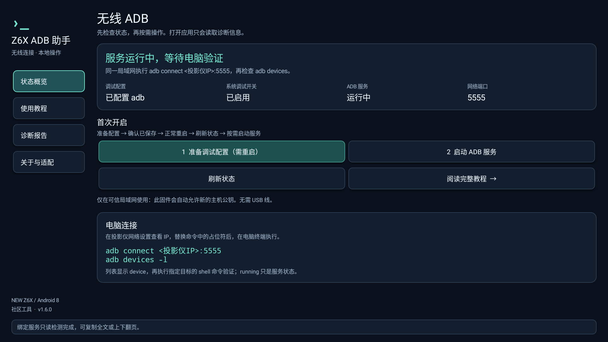
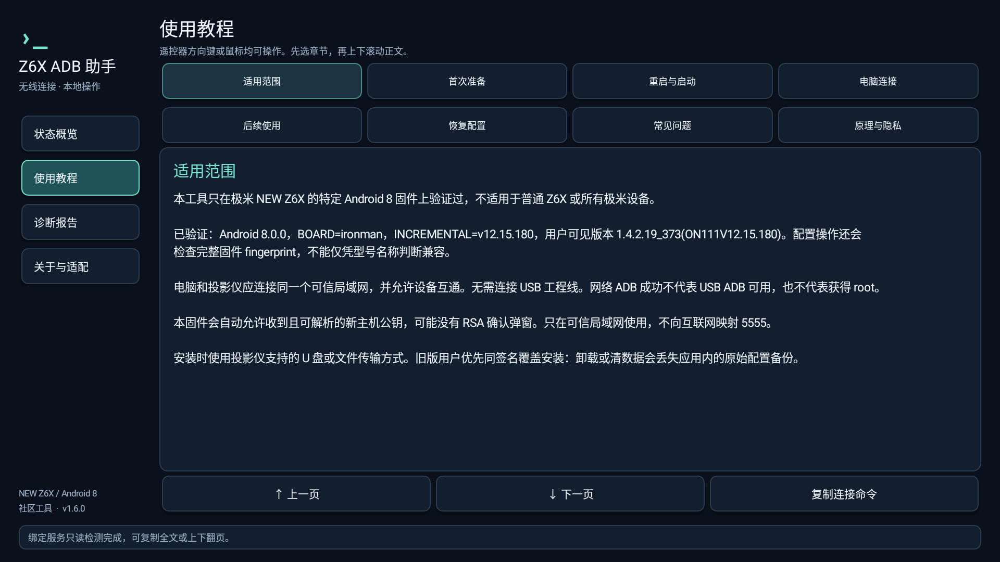

# Z6X ADB 助手

为极米 **NEW Z6X 特定 Android 8 固件**制作的无线 ADB 辅助工具，支持遥控器和鼠标操作，包含状态检测、配置备份、手动启停 ADB 服务、恢复预检与使用教程。

这是独立研究项目，与极米官方无隶属关系。它调用固件已有服务；没有找到或宣称替代原厂公开的 ADB 开启菜单。

本项目的静态研究、方案、源码、界面、编译与文档全程由 AI 辅助完成，用户配合实机操作并提供日志；已有实测结果与未验证边界分别记录。详见 [AI 辅助声明](docs/AI_DISCLOSURE.md)。

分析依据是官方 NEW Z6X `V12.15.180` 的 `XGIMI_IRONMAN_XH25L.bin`，并非通用 Android 教程或来源不明的刷机包。官方下载位置、文件大小、SHA-256 及实机应用更新差异见 [固件来源与分析对象](docs/FIRMWARE_PROVENANCE.md)。使用工具无需刷入该包。

## 下载与界面

[下载 v1.6.0 APK](https://github.com/dengfhqqq/xgimi-new-z6x-adb-helper/releases/tag/v1.6.0) · [详细教程](docs/USAGE.md) · [验证记录](docs/VERIFICATION.md)





## 支持范围

仅在以下设备与固件上完成过网络 ADB 连接和 shell 验证：

| 项目 | 已验证值 |
| --- | --- |
| 型号 | 极米 NEW Z6X；不是普通 Z6X |
| Android | 8.0.0 / API 26 |
| Board / Device | `ironman` |
| Incremental | `v12.15.180` |
| 用户可见系统版本 | `1.4.2.19_373(ON111V12.15.180)` |
| GMUI 属性 | `4.4.2.19` |

所有调试配置和服务启停写入都要求完整 fingerprint 精确匹配：

```text
Xgimi/ironman/ironman:8.0.0/OPR5.170623.014/v12.15.180:user/dev-keys
```

其他设备或版本可参考只读诊断结果，不能据此认定兼容，也不应删除保护条件强行启用。

## 首次使用

1. 将 APK 安装到投影仪，让电脑和投影仪连接同一个可信局域网。无需连接 USB 工程线。
2. 打开应用，先检测设备及配置，并选择“刷新状态”。初始持久配置为 `none` 时，选择 **准备调试配置（需重启）**。
3. 查看确认框，确认后应用会先保存原始配置，再请求设置；只有持久配置回读精确为 `adb` 才继续。
4. 使用投影仪的正常系统重启功能，随后重新打开应用并检测。若采用关机再开机，确认是真正重启而非待机唤醒；诊断报告中的系统运行秒数应重新计时。
5. 若 `adb_enabled=1`，而 ADB 服务为 `stopped`，选择 **启动 ADB 服务**，确认后再次检测。
6. 电脑安装 Android SDK Platform-Tools，替换下面命令中的地址后连接：

```bash
adb connect <投影仪IP>:5555
adb devices -l
adb -s <投影仪IP>:5555 shell id
```

`adb devices` 显示 `device` 且命令返回 `uid=2000(shell)` 才表示连接成功。应用内的 `running` 或配置回读成功不等于电脑已连上。

完整步骤、后续使用、恢复与故障判断见 [使用教程](docs/USAGE.md)，应用内也有离线教程。

## 已验证结果与限制

- 已验证特定 NEW Z6X 上的网络 ADB，权限是普通 `shell`，没有取得 root。
- 首次准备配置并正常重启后，系统的调试状态从 `0` 变为 `1`；该次重启后服务仍停止，手动启动后连接成功。没有验证每次重启后的自启动稳定性。
- 该固件的新主机公钥处理路径会自动允许主机，连接时可能没有 RSA 确认弹窗。只在可信局域网启用，不映射 5555 到互联网。
- USB 物理连接尚未枚举成功；网络 ADB 成功不能证明 USB ADB 或工程线可用。
- 恢复按钮只允许恢复本应用保存的原始 `none` 配置。已验证恢复预检和确认框，尚未实测完整恢复与重启闭环；不清除已保存的主机公钥。

## 实现范围

应用通过显式 Binder 绑定固件已有的服务，检查接口 descriptor 后，只使用核实过的读取及固定写入请求。没有打包厂商 SDK 初始化器、固件或反编译代码。

允许的固定写入只有：

```text
ctl.start=adbd
ctl.stop=adbd
persist.sys.usb.config=adb
persist.sys.usb.config=none  # 仅恢复有效备份
```

准备或恢复配置时，应用会检查设备与当前值、要求用户确认、重新绑定并回读、同步保存原始备份，然后请求写入并核验目标值。已是 `adb` 而没有备份时不会伪造原值。应用不直接写 `Settings.Global`、端口、安全属性、SELinux 或 sysfs，不自动重启。

## 构建与签名

需要 JDK 17 或 21 及 Android SDK（Platform 34、Build-Tools 34.0.0），项目不依赖厂商私有 SDK。先将 SDK 路径配置为 `TASK_ANDROID_SDK`，再运行：

```bash
export TASK_ANDROID_SDK="<Android SDK 目录>"
bash build.sh
```

默认输出 `dist/Z6X-ADB-Helper-v1.6.0.apk`、`dist/SHA256SUMS`，检查记录在 `build/v1.6.0/validation.txt`。运行 `bash test.sh` 可执行纯策略测试。

脚本会尝试 `TASK_ANDROID_SDK`、`ANDROID_SDK_ROOT`、`ANDROID_HOME` 和常用 SDK 目录。默认在本地生成开发签名，私钥与口令保存在被忽略的 `signing/` 目录。正式发布或覆盖更新应使用自己的固定签名：设置 `TASK_KEYSTORE`、`TASK_KEY_ALIAS`、`TASK_STORE_PASSWORD`，密钥口令不同时另设 `TASK_KEY_PASSWORD`；脚本通过环境变量传给签名工具。构建检查不等于每项设备功能都已实测。签名私钥、口令、设备日志和个人路径不应提交。自行构建使用不同证书时不能直接覆盖已有 APK；卸载或清数据会丢失应用内的原始配置备份。

## 隐私、发布与许可

无网络权限，不含广告或统计 SDK。诊断数据留在设备；复制或导出由用户触发。分享诊断报告前请检查内容，见 [隐私说明](docs/PRIVACY.md)。

版本记录见 [CHANGELOG](CHANGELOG.md)。源码按仓库 [LICENSE](LICENSE) 授权；Android、ADB 与厂商名称属于相应权利人。发布包不包含官方固件、厂商 APK、反编译产物或签名私钥。
